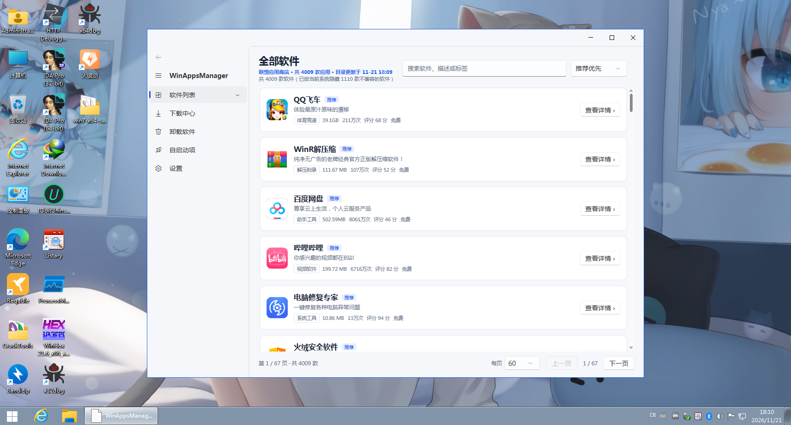
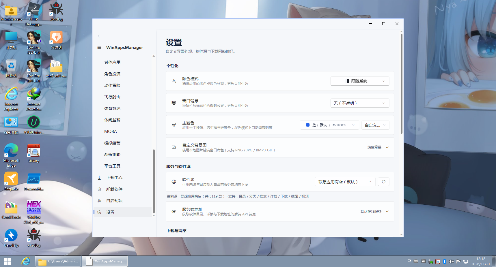
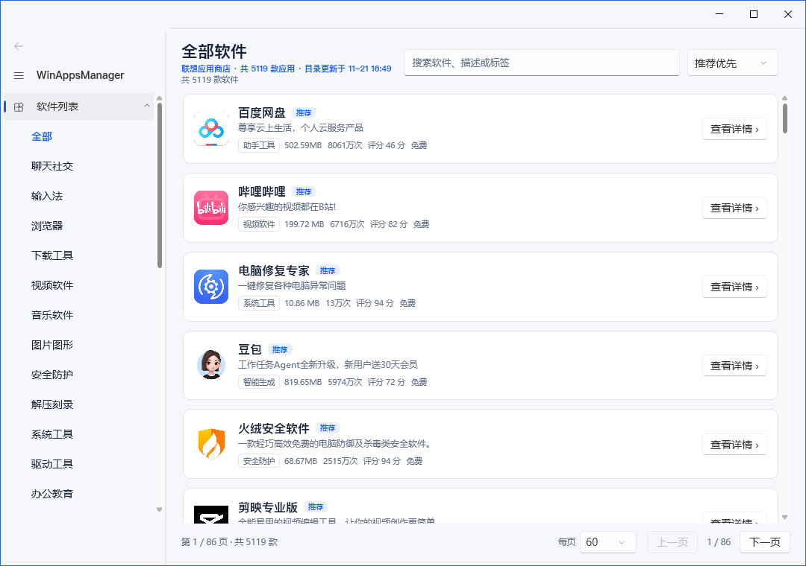
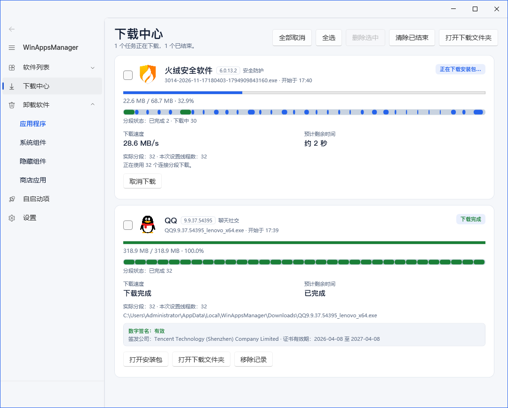
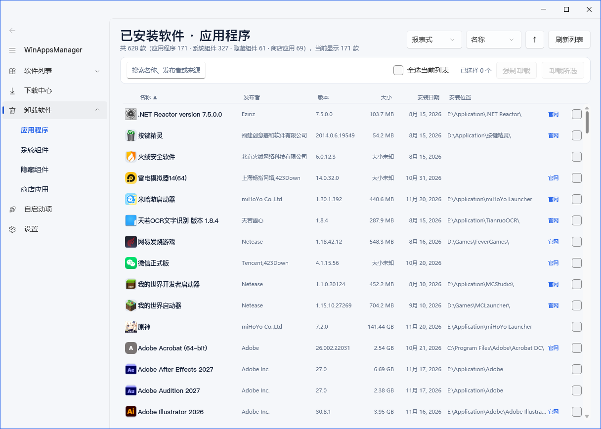
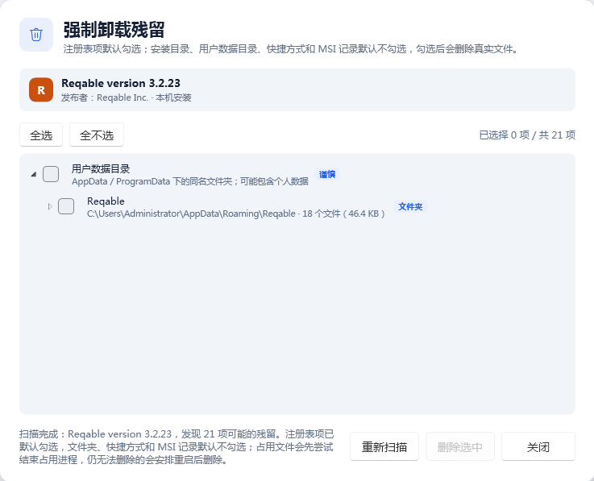
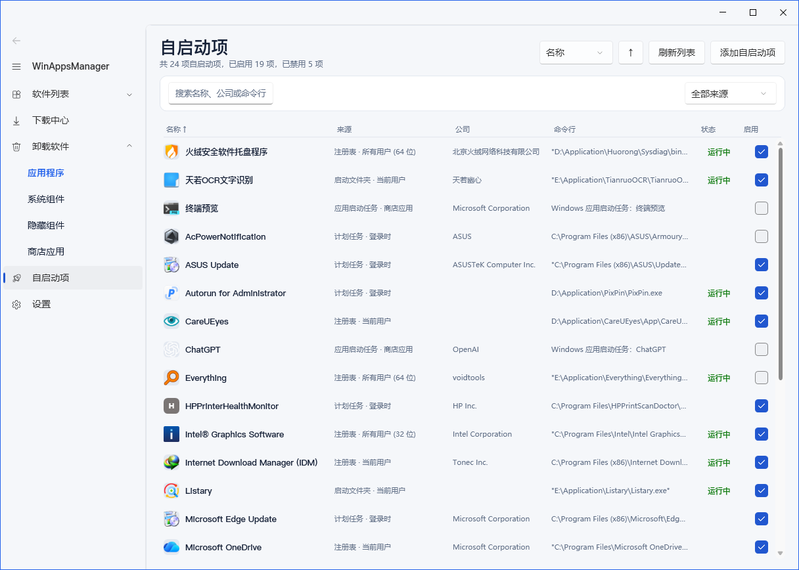
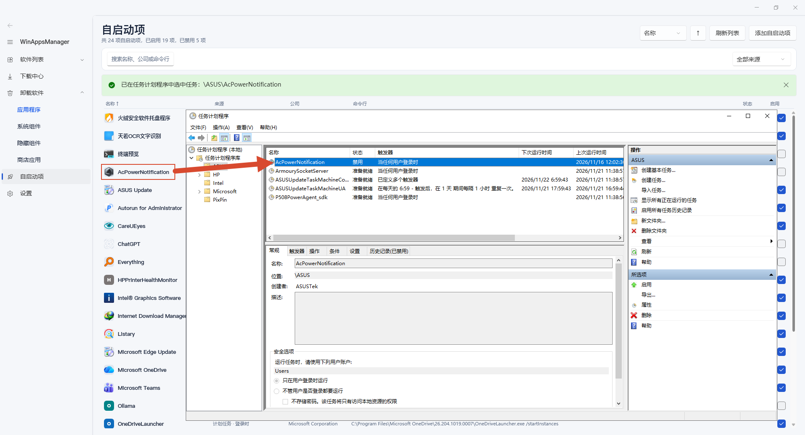
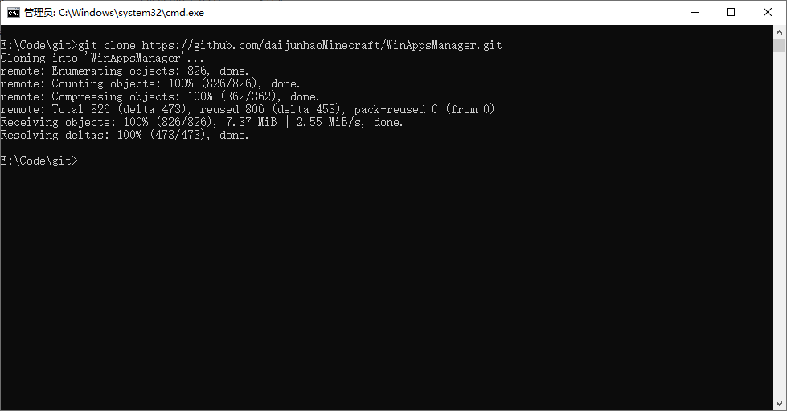
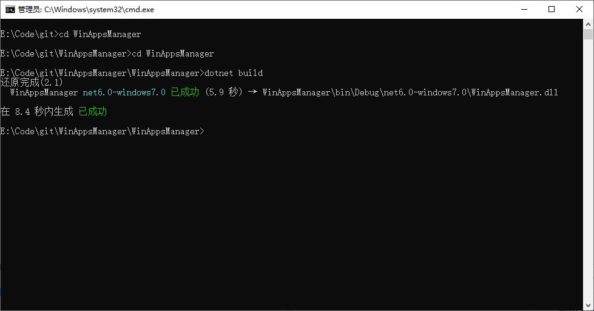

<div align="center">

# WinAppsManager

**WinAppsManager(Windows Applications Manager) 是一个开源无广现代化的 Windows 软件管理工具, 该工具旨在为用户带来一个 更方便/快捷 的 软件下载/管理 方式**<br/>

</div>

## 兼容性
 - 需要 Windows 7 SP1 版本及以上

## 下载方式
[Github Release](https://github.com/daijunhaoMinecraft/WinAppsManager/releases)

## 说明
为了兼容 Windows 7, 因此项目选择使用了 .NET 6.0, 同时为了有现代化的风格, 这里选择了 WPF 框架 + [iNKORE.UI.WPF.Modern](https://github.com/iNKORE-NET/UI.WPF.Modern) UI, 下面附 2 张 Windows 7 运行此软件的截图

<div align="center">

<br/>
软件列表页面

<br/>
设置页面

</div>

## 功能

**1. 软件商店**

<div align="center">

<br/>
软件商店页面
</div>

 - 内置了一些软件源(比如 [360 软件管家](https://cdn.soft.360.cn/view/home.html)软件源, [联想应用商店](https://lestore.lenovo.com))

**2. 下载中心**

<div align="center">

<br/>
软件下载界面
</div>

 - 支持查看数字签名以校验软件是否为官方软件
 - 支持查看每个线程的下载情况

**3. 卸载软件**

<div align="center">

<br/>
卸载软件列表

<br/>
清除残留功能

</div>

 - 支持卸载商店应用(也就是 Microsoft Store 上面下载的软件)
 - 支持清除残留(注册表/残留文件等)

**4. 自启动项**

<div align="center">

<br/>
自启动项管理界面

<br/>
预览来源
</div>

 - 支持禁用/启用软件自启动
 - 支持查询其中的来源(比如比如微软商店)
 - 支持跳转到自启动来源处(比如注册表/任务计划程序/普通自启动文件夹)
 - 高亮显示无效注册表(即为文件不存在的注册表)

## 构建方法

#### 准备工作
 - 下载并安装 [.NET 6.0 SDK](https://dotnet.microsoft.com/zh-cn/download/dotnet/thank-you/sdk-6.0.428-windows-x64-installer)
 - 系统版本为 Windows 7 及以上

Step 1. 克隆仓库到本地
```bash
git clone https://github.com/daijunhaoMinecraft/WinAppsManager.git
```
<br/>

Step 2. 构建程序
```
cd WinAppsManager
cd WinAppsManager
dotnet build
```
<br/>

## License

WinAppsManager is licensed under the **PolyForm Noncommercial License 1.0.0** with additional source-sharing and non-resale terms. Commercial use, resale, paid distribution, and closed-source distribution are not permitted. See [LICENSE](LICENSE).

Copyright (c) 2026 daijunhaoMinecraft

Lenovo, 360, and their respective product names, data, icons, and trademarks belong to their owners; this project is not affiliated with or endorsed by them.
The bundled Fluent System Icons font comes from Microsoft `fluentui-system-icons` and is used under the MIT License (see `WinAppsManager/Assets/Fonts/LICENSE.txt`).

## Star History

<a href="https://www.star-history.com/?repos=daijunhaominecraft%2Fwinappsmanager&type=date&legend=top-left">
 <picture>
   <source media="(prefers-color-scheme: dark)" srcset="https://api.star-history.com/chart?repos=daijunhaominecraft/winappsmanager&type=date&theme=dark&legend=top-left" />
   <source media="(prefers-color-scheme: light)" srcset="https://api.star-history.com/chart?repos=daijunhaominecraft/winappsmanager&type=date&legend=top-left" />
   
 </picture>
</a>