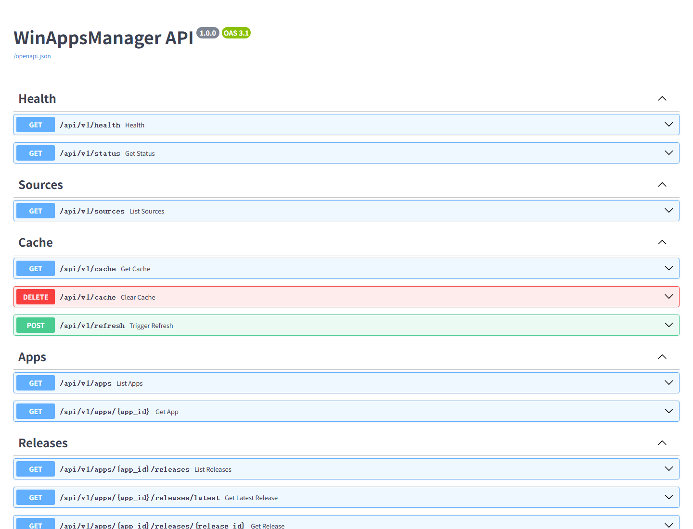

# WinAppsManager

Windows 软件管理器，使用 WPF 桌面前端和 FastAPI 后端。目前收录 45 款 Windows 软件，支持软件目录、搜索与分类、软件详情、软件图标、可保存的浅色/深色/跟随系统主题、安装包的并发下载、下载中心、实时进度和下载后打开，以及从 Windows 卸载注册表和当前用户 Microsoft Store/MSIX 包中读取已安装软件并批量卸载。客户端提供 Windows 7 SP1 兼容构建（不含商店应用）与 Windows 10 2004+ 完整版；目录中的软件按 `minimum_windows` 与 `architectures` 声明兼容范围，列表会按当前系统过滤。客户端支持两个软件源：**默认的联想应用商店**（由后端代理联想官方 PC 商店，目录约 5000 款，带截图相册、更新说明、评分与下载量）和**内置精选**（项目维护的 45 款软件资料；当前配置只启用 Clash Verge Rev 与 Telegram 两款，可用 `builtin.app_ids` 调整）。软件源可在设置页随时切换，服务端地址也可在设置页自定义（默认 `http://127.0.0.1:8080/`），软件源列表由服务端 `GET /api/v1/sources` 动态提供。

软件按分类为：开发工具 11、社交通讯 10、AI 助手 10、实用工具 5、影音工具 3、系统工具 2、网络与安全 2、办公效率 1、网络浏览 1。11 款使用专用来源解析器（原有 8 款，加上 WorkBuddy、DeepSeek Harness、豆包 3 款国内 AI 客户端），其余 34 款由后端的通用 GitHub Releases provider 读取官方仓库的正式发布；客户端看到的数据结构和下载流程对所有软件完全一致。

后端同时提供两个软件源：**内置精选**（目录里保留 45 款资料，默认配置只启用 Clash Verge Rev 与 Telegram 两款，走 `/api/v1/apps` 等既有接口）和**联想应用商店**（约 5111 款软件与游戏，由后端代理联想 PC 商店接口，`/api/v1/store/lenovo/*`），客户端默认使用联想源并可在设置中切换；`GET /api/v1/sources` 返回两个源的启用状态与已缓存数量，联想目录未加载时数量为 `null`（不会为统计触发抓取）。内置精选只对 `builtin.app_ids` 里的软件创建 provider 并参与启动预热与定时刷新，其余条目不请求 GitHub/官网；`builtin.enabled=false` 可整体关闭内置源（`/api/v1/apps*` 返回 503）。联想接口的调研结论（token、分类分页、搜索、详情、下载地址、图片 CDN）见 [`docs/lenovo-store-api.md`](docs/lenovo-store-api.md)，后端接线说明见 `Backend/README.md`。

软件列表页采用紧凑布局：左侧导航在“软件列表”下直接列出“全部”和各个分类，顶部一行完成搜索与排序/筛选（目录由后端每 5 分钟自动更新，客户端不提供刷新按钮）；右侧列表占满内容区。下载任务统一进入“下载中心”，离开详情页后仍继续显示进度。

> **源码公开（source-available）**：个人学习、研究与非商业用途免费使用；**禁止任何商业用途、倒卖、销售或付费分发**，详见 [LICENSE](LICENSE)。本仓库同时包含 WPF 客户端与 FastAPI 后端，仓库目前为私有状态，API 服务部署与安全审查完成后再转为公开。

## 截图

| 软件列表 | 软件详情 |
| --- | --- |
|  |  |

| 下载中心 | 设置与软件源 |
| --- | --- |
|  |  |

| 联想商店视频预览 | API 文档 |
| --- | --- |
|  |  |
## 项目结构

```text
WinAppsManager/
  WinAppsManager.sln
  WinAppsManager/          WPF 前端，双目标 .NET 6（Win7 SP1+）/ .NET 8（Win10 2004+）
    Models/               API 数据、下载进度、设置与已安装软件模型
    Pages/                软件列表、软件详情、下载中心、卸载软件、设置
    Dialogs/              卸载二次确认与可停止的进度窗口
    Services/             API 客户端、下载任务、卸载服务、主题设置
Backend/
  main.py                 FastAPI 入口
  models.py               API / 目录数据结构
  catalog.py              软件与版本资源查询（合并 apps.json 与 apps.d）
  cache.py                共享内存版本缓存与统计
  persistence.py          磁盘版本快照（重启后复用）
  config.py               配置读取、校验与环境变量覆盖
  config.json / config.local.json  运行配置；本地的 config.local.json 存 GitHub 令牌（已 gitignore）
  icons.py                固定图标与 HTTP 条件缓存
  releases.py             提供器调用与版本解析
  providers/              获取官方版本及下载签名的插件，github.py 为通用 GitHub Releases 来源，_github_cache.py 保存 GitHub 条件请求缓存
  lenovo/                 联想应用商店源：token/目录/详情/图片/服务门面，routes.py 是对客户端暴露的 /store/lenovo 路由
  data/apps.json          原有 8 款软件资料
  data/apps.d/*.json      37 款扩展软件（同一 schema，按文件名合并）
  icon/                   45 个固定图标与来源说明
  tests/                  REST API 自动验证
```

软件资料和下载提供器统一由后端管理。QQ、微信、VS Code、7-Zip、VLC、Firefox、OBS Studio 和 Notepad++ 使用各自的专用解析器（QQ 另调用腾讯下载签名服务），WorkBuddy、DeepSeek Harness、豆包 3 款国内 AI 客户端也由专用提供器解析；其余通过 GitHub Releases 通用 provider 读取官方仓库的正式发布。客户端对所有软件使用同一套 API、架构选择、下载与校验流程；`provider_spec`、`download_provider` 等内部字段不会出现在 API 响应里。前端在 `Services/AppCatalogService.cs` 中默认使用 `http://127.0.0.1:8080/`，可在设置页修改服务端地址，请求 `/api/v1` 下的资源接口，不包含静态软件目录。

## 支持的软件

| 分类 | 数量 | 软件 |
| --- | ---: | --- |
| 开发工具 | 11 | Visual Studio Code、Notepad++、Git for Windows、PowerShell 7、Neovim、VSCodium、DBeaver Community、GitHub Desktop、Zed、Bruno、GitHub CLI |
| 社交通讯 | 10 | QQ、微信、Telegram Desktop、Jitsi Meet、Mattermost、Zulip、Rocket.Chat、Ferdium、Revolt、Session |
| AI 助手 | 10 | Ollama、Jan、Cherry Studio、AnythingLLM、GPT4All、LobeHub、Goose、WorkBuddy、DeepSeek Harness、豆包 |
| 实用工具 | 5 | 7-Zip、ShareX、Rufus、LocalSend、Motrix |
| 影音工具 | 3 | VLC media player、OBS Studio、mpv.net |
| 系统工具 | 2 | Microsoft PowerToys、QuickLook |
| 网络与安全 | 2 | KeePassXC、Clash Verge Rev |
| 办公效率 | 1 | Obsidian |
| 网络浏览 | 1 | Firefox |

分类由后端目录提供，客户端按它动态生成左侧导航，新增软件不需要改客户端代码。后端内置精选源当前只启用 Clash Verge Rev 与 Telegram 两款（`builtin.app_ids`），其余条目资料保留但不出现在内置源列表、也不抓取版本。GitHub 上的软件使用官方 `.exe` / `.msi` / `.msix` / `.msixbundle` 发布资产，因此 PowerShell 7、Neovim、GitHub CLI、Mattermost、Zulip、KeePassXC 等下载到的是 MSI 或 MSIX，而不是 EXE。部分软件（例如 Discord、Slack、WhatsApp、飞书、钉钉、Signal、Element、Chatbox、LM Studio、SumatraPDF，以及 Bitwarden 的安装器）在 GitHub 上没有可用的安装包资产，本版本未收录，请不要按“已支持”理解。新增软件的字段、资产正则、图标要求和验证步骤见 `Backend/data/apps.d/README.md`。

### 适用系统与架构

后端为 45 款软件都核实并声明了 `minimum_windows`（最低 Windows 版本）与 `architectures`（该软件官方后端实际能提供的安装包架构），`platforms` 是展示文案（格式为「系统版本 · 架构」）。客户端列表会按当前 Windows 版本与 CPU 架构隐藏不兼容条目，并在数量旁显示「已按当前系统隐藏 N 款不兼容的软件」。

| 适用系统（`minimum_windows`） | 数量 | 软件 |
| --- | ---: | --- |
| Windows 7 SP1 及以上 | 4 | 微信、7-Zip、Telegram Desktop、VLC media player |
| Windows 8 及以上 | 2 | Neovim、Rufus |
| Windows 8.1 及以上 | 1 | Notepad++ |
| Windows 10 及以上 | 37 | 其余软件（含 QQ、VS Code、Firefox、PowerShell 7、OBS Studio 等） |
| Windows 11 | 1 | Mattermost |

架构方面，45 款都提供 x64；提供 x86 安装包的有 13 款：QQ、微信、7-Zip、Telegram Desktop、VLC media player、Firefox、OBS Studio、Notepad++、PowerShell 7、GitHub CLI、Rocket.Chat、Ferdium、Rufus；提供 arm64 的有 29 款。`/api/v1/apps?architecture=x86` 只会返回这 13 款，32 位系统看不到只提供 x64 的软件。

### 三款国内 AI 客户端来源

WorkBuddy、DeepSeek Harness 和豆包不在 GitHub 发布，由后端专用提供器解析，都只提供 Windows x64 安装包：

| 软件 | 版本来源 | 安装包 | 校验与风险 |
| --- | --- | --- | --- |
| WorkBuddy | `https://www.workbuddy.cn/v2/update?platform=workbuddy-win32-x64-user` 返回的 JSON（`version`、`sha256hash`） | `download.codebuddy.cn` 上的完整安装包 | 官方提供 SHA256 |
| DeepSeek Harness | `HEAD https://download.deepseek.com/desktop/dsh-latest-windows-x64.exe` 的 `Content-Disposition` 文件名（如 `deepseek-harness-0.2.2-rc.3-win-x64.exe`） | `dsh-latest-windows-x64.exe` 最新别名，`file_name` 就是 URL 最后一段 | 官方不提供 SHA256；CDN 最长约 24 小时缓存，版本更新可能滞后一天 |
| 豆包 | `POST https://99uri.com/ug/pc/landpage_click` 返回的在线安装器文件名里的构建号（如 `2035012`） | UG 渠道 CDN 上约 7.4 MB 的在线安装器，运行后需联网下载完整程序 | 无 SHA256；请求依赖官网前端硬编码的 `surl_token`，官网改版后可能失效，届时该软件按降级规则暂时从列表消失；版本号是安装器构建号，不是产品语义版本 |

## 软件源

客户端支持两个软件源，可在**设置 → 软件源**中切换，默认使用联想应用商店：

| 软件源 | 内容 | 说明 |
| --- | --- | --- |
| 联想应用商店（默认） | 联想官方 PC 商店目录，约 5000 款软件与游戏，含安装大小、下载量、评分、榜单、Beta 标记、标签、更新说明、封面与截图 | 由本机后端代理联想接口并缓存，客户端不直连联想业务接口；图标由客户端按后端给出的联想 CDN 地址直连取图（失败回退后端代理），截图与封面仍经后端代理 |
| 内置精选 | 项目维护的 45 款软件资料，当前配置只启用 Clash Verge Rev 与 Telegram 两款（`builtin.app_ids`） | 后端解析官网/GitHub 版本与下载地址；其余条目保留但不创建 provider、不参与预热/定时刷新 |

切换软件源会保存到 `settings.json`、清空按源隔离的本地目录缓存并重新加载软件目录，已经开始的下载任务不受影响；切换失败时界面会提示并保留原来的软件源。设置页的软件源下拉框从当前服务端的 `GET /api/v1/sources` 加载：服务端标记为不可用的源会显示“（不可用）”且不能选择，若已保存的源在服务端不可用，客户端会自动回退到服务端默认的可用源；服务端不可达时回退到本地静态的两项。联想源目录较大，因此列表图标**按行按需加载**（滚动到可见行才请求），不会一次性预热全部图标；本地目录搜索不到结果时，空状态会提供“在联想商店在线搜索”，在线结果会在状态行标注并可“返回本地目录”。

后端地址可以在**设置 → 服务端地址**中自定义（默认 `http://127.0.0.1:8080/`，可配合反向代理/远程部署）：保存前会校验 http(s) 绝对地址并可选“测试连接”（请求 `GET /api/v1/health`，5 秒超时），切换后会清空内存目录和按服务端隔离的本地缓存、重新连接新的服务端；已经开始的下载任务不受影响，之后的任务使用新服务端返回的地址。

联想源的列表与详情由后端 `/api/v1/store/lenovo/*` 提供：联想接口、缓存与字段映射见 [docs/lenovo-store-api.md](docs/lenovo-store-api.md)，客户端与服务端的整体设计见 [docs/store-source-design.md](docs/store-source-design.md)。后端的 `GET /api/v1/sources` 会返回两个源的启用状态与软件数量。

## 启动

在项目根目录使用 PowerShell 7，先启动后端（Python 3.10 或更高版本）：

```powershell
python -m venv Backend\.venv
.\Backend\.venv\Scripts\python.exe -m pip install -r Backend\requirements.txt
.\Backend\.venv\Scripts\python.exe Backend\main.py
```

再在另一个终端启动前端，需要 .NET SDK 与对应的桌面运行时。默认使用 **Windows 7 兼容目标**（.NET 6 是最后一个支持 Windows 7 SP1 的 .NET 版本）：

```powershell
dotnet run --project WinAppsManager\WinAppsManager\WinAppsManager.csproj -f net6.0-windows7.0
```

客户端是双目标项目，必须用 `-f` 指定目标框架，可用两档配置：

| 目标框架 | 适用系统 | 商店应用管理 | 运行时 |
| --- | --- | --- | --- |
| `net6.0-windows7.0`（默认） | Windows 7 SP1 / 8 / 8.1 / 10 / 11 | 不包含（界面会提示不支持） | .NET 6 Desktop Runtime（net6 已 EOL，无安全更新） |
| `net8.0-windows10.0.19041.0` | Windows 10 2004+ / 11 | 完整支持（WinRT `PackageManager`） | .NET 8 Desktop Runtime |

Windows 7 上运行 `-f net6.0-windows7.0` 构建（Win7 需要 SP1 与必要系统更新，并安装 .NET 6 Desktop Runtime）。在 Rider 中已预置两个运行配置：`WinAppsManager (Windows 7 兼容)`（默认，net6）和 `WinAppsManager (Windows 10+)`（net8）；`WinAppsManager\.idea\runConfigurations\` 下是这两个配置，默认运行键使用 Windows 7 兼容目标。后端要求 Python 3.10+，只能在 Windows 10/11 上运行；客户端默认连接本机 `127.0.0.1:8080`，也可在设置页改成其他服务端地址（远程后端需要自行保证网络可达），所以 Windows 7 上目前还用不到依赖后端的目录/下载功能（卸载与设置可离线使用）。

发布：Windows 7 版本使用 `net6.0-windows7.0` 目标（.NET 6 是最后一个官方支持 Windows 7 SP1 的 .NET 版本）。发布配置在 `Properties/PublishProfiles/`：

| 配置 | 说明 |
| --- | --- |
| `Win7-x64.pubxml` / `Win7-x86.pubxml` | 框架依赖发布（推荐，体积小）；目标机器需安装 .NET 6 Desktop Runtime（Win7 需 SP1 与必要系统更新） |
| `Win7-x64-selfcontained.pubxml` / `Win7-x86-selfcontained.pubxml` | 自包含发布（约 166 MB）；自带 .NET 6 运行时，目标机器无需预装 .NET 6 Desktop Runtime |

```powershell
# 框架依赖（x86；x64 用 -r win-x64 与 Win7-x64）
dotnet publish WinAppsManager\WinAppsManager\WinAppsManager.csproj -c Release -f net6.0-windows7.0 -r win-x86 -p:PublishProfile=Win7-x86
# 自包含（x64）
dotnet publish WinAppsManager\WinAppsManager\WinAppsManager.csproj -c Release -f net6.0-windows7.0 -r win-x64 -p:PublishProfile=Win7-x64-selfcontained
```

把 `-r` 换成 `win-x64`、`-f` 换成 net8 目标即可发布 64 位完整版（Win10 2004+）。

API 文档：<http://127.0.0.1:8080/docs>（Swagger UI 静态资源随后端一起提供，离线/无外网 CDN 也能打开）。后端未启动或网络请求失败时，前端会显示错误和重试入口。

后端在开始接受请求之前会先做一次启动预热：按 `refresh.on_startup`（默认开启）抓取内置精选源当前启用的软件（默认配置只有 Clash Verge Rev 与 Telegram 两款）的官网/仓库版本，抓取失败时回退到磁盘上的旧快照，整体预算默认 30 秒（`refresh.startup_timeout_seconds`）；默认并发为 4，实测整轮预热十余秒。预热完成后启动定时刷新（默认每 30 分钟一轮）。内置精选目录里其余 43 款保留资料但不创建 provider、不参与预热与定时刷新。预热、陈旧快照回退、定时刷新和诊断接口的完整说明见 `Backend/README.md`。联想应用商店目录**不在启动预热范围内**：启动时只创建联想服务，目录/详情/搜索在第一次请求时按需抓取，不拖慢启动；联想源默认启用，可用 `lenovo.enabled=false` 关闭。

34 款软件通过 GitHub API 读取版本；未认证配额只有 60 次/小时，建议在本机配置令牌提升到 5000 次/小时：把 `{"github":{"token":"..."}}` 放进 `Backend/config.local.json`（该文件已加入 `Backend/.gitignore`，不要提交），或设置环境变量 `WINAPPSMANAGER_GITHUB_TOKEN`（优先级最高）。令牌只通过 `Authorization` 请求头发送，不会写入日志、缓存或 API 响应；`GET /api/v1/cache` 中只显示 `***` 和 `token_configured`。后端还会把每个 GitHub 仓库的响应体、`ETag` 和 `Last-Modified` 缓存到磁盘：重启后 900 秒内（`github.refresh_interval_seconds`）直接复用、不发请求，超过间隔才发条件请求，数据未变化时返回 304 且不消耗配额。配置修改后需要重启后端。

## 部署

仓库同时包含可部署的 FastAPI 后端：根目录提供 `Dockerfile` / `docker-compose.yml`，`deploy/` 下有 systemd 单元与 Caddy 反向代理示例，完整步骤与安全清单见 [`docs/deploy.md`](docs/deploy.md)。

- 推荐生产方式：后端只监听 `127.0.0.1:8080`，由 Caddy/Nginx 提供 HTTPS，并屏蔽 `POST /api/v1/refresh`、`POST /api/v1/store/lenovo/refresh`、`/api/v1/cache*` 等管理接口。
- 客户端在设置页把“服务端地址”改成 `https://api.example.com/` 即可连接远程后端；软件源仍由 `GET /api/v1/sources` 动态发现。
- 仓库当前为私有，API 公网部署与安全审查完成后再转为公开（命令与检查项见部署文档）。
## REST API

| 方法 | 资源路径 | 用途 |
| --- | --- | --- |
| GET | `/api/v1/health` | 服务状态 |
| GET | `/api/v1/sources` | 软件源列表：联想应用商店（默认）与内置精选的启用状态、已缓存数量与更新时间 |
| GET | `/api/v1/status` | 预热/可用性状态与定时刷新诊断 |
| POST | `/api/v1/refresh` | 立即触发一轮版本刷新，并发调用合并 |
| GET | `/api/v1/apps` | 软件集合，支持搜索、分类、排序与按 `architecture` 过滤 |
| GET | `/api/v1/apps/{app_id}` | 软件详情，支持 `architecture` |
| GET | `/api/v1/apps/{app_id}/releases` | 版本集合，默认全部架构，可筛选架构 |
| GET | `/api/v1/apps/{app_id}/releases/latest` | 最新版本与新签名，支持 `architecture` |
| GET | `/api/v1/apps/{app_id}/releases/{release_id}` | 版本信息与直接下载地址 |
| GET | `/api/v1/apps/{app_id}/icon` | 软件图标 |
| GET | `/api/v1/store/lenovo/categories` | 联想商店分类树（`groups` 含软件/游戏分类） |
| GET | `/api/v1/store/lenovo/apps` | 联想商店完整目录（只读内存/磁盘缓存；GET 查询参数不会触发抓取） |
| POST | `/api/v1/store/lenovo/refresh` | 同步强制刷新联想目录并写回 `catalog.json`（服务端手动刷新接口；客户端已无刷新按钮） |
| GET | `/api/v1/store/lenovo/apps/{soft_id}` | 联想应用详情（只读缓存；GET 不会强制刷新） |
| GET | `/api/v1/store/lenovo/apps/{soft_id}/download` | 实时解析联想下载地址（返回 `release` 结构，`no-store`），`architecture` 可选 |
| GET | `/api/v1/store/lenovo/search` | 联想在线搜索，`q` 1–100 字符、`limit` 1–50（默认 30） |
| GET | `/api/v1/store/lenovo/apps/{soft_id}/icon` | 联想图标代理（长 TTL + ETag/304） |
| GET | `/api/v1/store/lenovo/apps/{soft_id}/screenshots/{index}` | 联想截图/视频缩略图代理（长 TTL + ETag/304） |
| GET | `/api/v1/store/lenovo/apps/{soft_id}/screenshots/{index}/video` | 联想视频播放代理：实时解析带时效的视频地址并流式转发，支持 Range/206 拖动进度，`no-store`、不缓存签名 URL |
| GET | `/api/v1/store/lenovo/apps/{soft_id}/cover` | 联想横版封面代理（长 TTL + ETag/304） |

集合响应采用 `{"items": [...], "total": n}`，`total` 是实际返回的条目数。列表会按目录声明的 `architectures` 过滤（未声明的旧条目视为兼容所有架构），详情与版本接口不隐藏软件、只按架构选择安装包；`minimum_windows` 不参与后端过滤，由客户端按本机系统隐藏。列表逐个软件解析，单个软件抓取失败只会从本次响应中略过，接口整体仍返回 200；既抓取失败又没有可用快照的软件不会出现在列表里（`refresh.drop_unavailable_apps` 默认开启），其详情返回 503。非强制刷新的列表与详情在插件暂时不可用时会回退到持久化旧快照；`refresh=true` 时列表对失败的软件会再按非强制刷新回退一次（有快照就不会消失），而详情与 latest 的上游故障仍返回 502、超时仍返回 504。未知资源返回 404，不合法的查询参数返回 422，`architecture` 可选 `x64`、`x86` 或 `arm64`，列表、详情与 latest 默认使用 x64。详细字段与添加软件插件的方法见 `Backend/README.md`。

联想应用商店源使用独立前缀 `/api/v1/store/lenovo`：分类树、完整目录（GET 只读缓存，不提供强制刷新）、应用详情、实时下载地址（`Cache-Control: no-store`，地址从不缓存）、在线搜索、图标/截图/封面代理（长 TTL + ETag，命中 `If-None-Match` 返回 304）以及 `POST /refresh` 手动刷新目录。目录与搜索条目里的 `icon_url` 是联想 CDN 的绝对地址（客户端直连取图并本地缓存），`icon_proxy_url` 是后端代理的相对兜底路径；截图与封面仍是后端代理相对路径。联想源未启用（`lenovo.enabled=false`）时这些路由返回 503，应用不存在或已下架返回 404，联想上游协议/网络错误返回 502、超时返回 504；`/sources` 与联想目录/详情/搜索/下载/刷新响应都是 `no-store`。联想的原始接口与字段说明见 [`docs/lenovo-store-api.md`](docs/lenovo-store-api.md)。

内置精选源的启用范围由 `Backend/config.json` 的 `builtin` 段控制：`enabled`（总开关，`false` 时 `/api/v1/apps*` 与 `POST /api/v1/refresh` 返回 503、不创建 provider/不预热/不启动定时刷新）与 `app_ids`（启用白名单，空列表表示全部 45 款；默认只启用 `clashverge` 与 `telegram`，白名单里出现未知 id 会让后端启动失败）。`GET /api/v1/sources` 的 `builtin.app_count` 是过滤后的数量。

## 下载流程

打开软件详情，点击“开始下载”。客户端按 Windows 操作系统架构请求 `releases/latest`，后端重新读取官方版本和安装器地址，QQ 会额外获取新签名。随后客户端自动进入“下载中心”，从 `download_url` 下载安装包；详情页只负责发起任务和显示链接，不再占用空间显示进度。

详情页会显示当前安装包的直链地址，可直接选中复制或点击“打开”；没有安装包直链时显示官网下载页。直链由软件服务临时生成，复制和下载时会重新获取最新地址，避免使用过期签名。联想商店详情页的截图/视频相册支持点击打开大图预览；**视频条目可在预览窗口内直接播放**（后端代理流式转发、支持拖动进度、播放/暂停/静音，失败可回退到浏览器打开），播放依赖系统媒体组件（Win7 需系统自带 MP4/H.264 支持）。

联想应用商店源的软件安装包由联想商店提供，详情页的“开始下载”不要求目录里预先存在下载链接：点击后由下载中心向后端实时解析地址，再交给同一套分段下载与校验流程。详情页会提示“安装包由联想应用商店提供，开始下载后可在下载中心查看进度”；获取链接失败时仍可点击“开始下载”，下载中心会在开始时重新解析。内置精选源的下载行为与之前完全一致。

下载默认使用 **4 个并发连接**，可在设置页的“下载”卡片中用滑杆把线程数调整为 **1–32**；下载超时也可用滑杆设置为 **10–300 秒**。超时时间用于连接服务器和每次读取数据，超时后任务会停止并可在下载中心重试。设置会保存到 `settings.json` 并用于新下载；正在进行的下载继续使用启动时的配置。更高的并发数不保证更高的速度。

安装包默认保存到 `%LOCALAPPDATA%\WinAppsManager\Downloads`。设置页的“下载位置”可以改成任意绝对路径（例如 `D:\Downloads`，支持 `%USERPROFILE%` 等环境变量；目录不存在时会自动创建），也可以点“浏览…”用系统文件夹选择窗口挑选；点“恢复默认”回到默认目录。修改只影响之后开始的下载任务，下载中心和任务卡片里的“打开下载文件夹”始终打开当前设置的目录。

设置页提供 GitHub 加速镜像，可留空直连，也可以从 gh-proxy.com、ghfast.top、ghproxy.net 等预设中选择或填写自定义前缀。镜像仅对 `github.com`、`raw.githubusercontent.com` 等 GitHub 下载链接生效，格式为“镜像前缀 + 原始 URL”。第三方镜像会看到下载请求，安装包仍会按容器格式校验并执行官方 SHA256 校验（`.exe` 查 PE 头，`.msi` 查 OLE 签名，`.msix`/`.msixbundle`/`.appx` 查 ZIP 头）。

网络设置支持**跟随系统代理、直连、自定义 HTTP/HTTPS 代理**三种模式，并可选择忽略安装包下载的 HTTPS 证书错误。忽略证书会跳过中间人校验，界面会持续显示危险提示，仅建议本地调试时启用。代理和证书设置用于之后开始的安装包下载，不影响本机后端 API 的直连访问；更改不会影响正在进行的任务。

下载中心为每个任务显示应用、版本、状态、总进度、已下载字节、总速度、预计剩余时间和实际连接数，并用一条分段带状进度条按段显示每个部分的进度与状态：每格对应一个下载分段，按等待、下载中、已完成、失败等状态着色。多个软件的下载任务可以同时存在；离开页面或进入设置不会中断下载。

多连接下载会先检查服务器是否支持 HTTP Range，并校验各分段的返回范围与长度。小文件、总大小未知、服务器不支持分段，或无法保证分段属于同一文件时，自动使用单连接；下载中心会显示实际使用的连接数和回退状态。分段读取过程中发现服务器退回完整响应时，也会停止分段并安全改用单连接。

所有传输完成后才进行安装包验证：按扩展名检查对应容器头——`.exe` 查 `MZ`/`PE` 头，`.msi` 查 OLE 复合文档签名，`.msix` / `.msixbundle` / `.appx` 查 ZIP 头，并核对下载长度；官方提供 SHA256 时再检查完整文件哈希。验证通过后才保存为正式安装包；任务卡片会显示“打开安装包”和“打开下载文件夹”入口。取消、传输失败或校验失败不会进入打开安装包流程，可点击“重新下载”重试。安装包不会自动执行，只有用户点击“打开安装包”才启动。

安装包保存在 `%LOCALAPPDATA%\WinAppsManager\Downloads`。下载过程使用独立的 `.part` 文件，取消或失败时清理临时文件；已有安装包不会被重复下载覆盖。退出客户端时会先取消并等待正在进行的下载，再关闭窗口。

当前目录中的 45 款软件都已接入动态版本来源：11 款使用各自的专用解析器，34 款使用通用 GitHub Releases provider。后端共享版本缓存默认内存 5 分钟、磁盘快照 1 小时，下载和复制链接时强制刷新；这些 TTL、缓存目录和条目上限（128）可在 `Backend/config.json` 中调整，也可用 `WINAPPSMANAGER_*` 环境变量覆盖。QQ 每次重新签名。目录用 `minimum_windows`（7/8/8.1/10/11）与 `architectures`（x64/x86/arm64）声明每款软件实际提供的安装包，客户端按当前系统与架构过滤；PowerShell 7 提供 MSIX Bundle，Neovim / GitHub CLI / Mattermost / Zulip / KeePassXC 提供 MSI，WorkBuddy、DeepSeek Harness 和豆包只有 x64。其他架构详情见 `Backend/README.md`。无对应安装器时提供官网下载页入口。

## 卸载软件

左侧“卸载软件”页读取 Windows 的卸载注册表项（本机 64/32 位视图和当前用户），同时通过 WinRT `PackageManager` 枚举当前用户的 Microsoft Store/MSIX 应用，并按四个视图分类展示：**应用程序 / 系统组件 / 隐藏组件 / 商店应用**（分类依据 `SystemComponent`、`ParentKeyName`、`ReleaseType`、`NoRemove`）。列表包含名称、版本、发布者、安装分类、大小、安装日期和安装位置，左侧导航“卸载软件”展开后就是这四个分类（没有“全部”，默认停在应用程序），切换分类和切换软件列表分类的手感一致；非应用程序的行会带“系统 / 隐藏 / 商店”徽章，页面标题显示当前分类，标题行同时显示各分类数量。列表还支持排序（名称 / 发布者 / 大小 / 安装日期，升降序可切换）、搜索、全选当前列表、逐项勾选和批量卸载；显示方式有“报表式”（默认，带可点击列头的固定列表格）、“列表式”（紧凑单行）和“卡片式”三种，三者都会显示软件图标。安装日期显示为 `8月 15, 2026`，没有日期时留空。每行会显示软件大小与安装日期：注册表没有记录时，后台按系统规则补齐——大小递归统计安装目录（单目录 8000 个条目 / 400ms 上限），安装日期则依次回退到注册表 `InstallDate`、卸载键最后写入时间与安装目录最后写入时间中更早的一个，所以只有 `DisplayIcon` 的软件也能显示日期。安装目录按 `InstallLocation` → `Inno Setup: App Path` / `InstallDir` → `DisplayIcon` 所在目录 → 卸载程序所在目录的顺序解析，只有这些都取不到时才留空。后台补全只处理当前分类的可见条目，切换分类会重新排队。深度清理桌面软件和商店应用都支持：桌面软件扫注册表与文件系统，商店应用扫 `AppModel\PolicyCache` / `AppModel\SystemAppData` 下该包族名对应的状态键。结果树默认收起。卸载键里有 `URLInfoAbout`（或 `HelpLink`）的软件会显示“官网”按钮，右键菜单也能直接打开官网。商店应用会过滤 framework、resource package、bundle、stub 和没有应用入口的包。

商店应用使用包提供的本地化显示名、发布者、版本和安装时间；图标取 `AppxManifest.xml` 的 Logo，并优先使用同名的 `.targetsize-48`、`.scale-200` 等缩放资源，避免显示 100% 小图。每个商店包显示为一条记录，卸载单位是包。商店应用只会从当前 Windows 用户卸载，不使用 `-AllUsers`，不会影响其他用户；卸载命令使用 `Get-AppxPackage -Name <包名> | Remove-AppxPackage`，因此会同时删除该应用在本机的用户数据，不做预置包 deprovision；部分预置应用可能在下次登录时重新部署。

Windows 7 兼容构建（`net6.0-windows7.0`）不包含 WinRT 商店应用管理：卸载页的“商店应用”分类为空，状态栏会提示需要 Windows 10 2004 及以上；其他三类桌面软件不受影响。

如果条目的 `DisplayIcon` 指向 EXE、DLL 或 ICO，客户端会在后台提取图标并显示；商店应用则加载包提供的 PNG Logo。图标本身不额外添加彩色底，没有可用图标时才显示字母徽章。图标按路径、资源索引或文件 URI 缓存，不影响卸载操作。

选中一个或多个软件后点击“卸载所选”，会先弹出二次确认框，列出全部软件并提示卸载过程中可以停止，但软件可能停留在部分卸载状态。确认后会显示模态进度窗口，按顺序逐个启动各软件注册的厂商卸载程序，并等待该卸载程序及其创建的整棵进程树结束；启动前应保存工作并关闭正在使用的软件。部分软件会弹出自己的卸载向导或 Windows 权限提示，需要用户在其中继续操作。列表行支持右键菜单：卸载此软件、打开安装位置、复制软件名称、复制卸载命令、刷新列表。

进度窗口中点击“停止卸载”（或直接关闭窗口）会取消当前批次，并终止正在运行的卸载程序及其全部子进程；已经开始的卸载不会被回滚，当前软件会被记为“已取消”，剩余软件会被跳过。

每批卸载结束后，客户端不会只相信卸载程序的退出码，而是回到注册表核对：桌面软件按卸载键路径检查、商店应用按包全名查询。注册表键已经不存在即判定为“已卸载”，键仍然存在则判定为“仍有残留”，结果列表会分别显示这两种状态，汇总里也会给出“其中 N 个已通过注册表确认移除”。

对于仍然残留的桌面软件，可以用工具栏“深度清理”或行右键“深度清理残留…”打开深度清理窗口：

- 扫描分成九组：注册表侧是卸载登记项、`HKCU`/`HKLM\Software`（含 32 位视图）下与软件名或安装目录同名的键、键值仍指向安装目录的键、`Run`/`RunOnce` 启动项、`Services` 和 `App Paths`；文件侧是软件的安装目录、`AppData`/`ProgramData`/`LocalAppData\Programs`/`LocalLow` 下的同名目录、开始菜单和桌面上的快捷方式；MSI 侧按卸载键里的 ProductCode 查询 `Installer\UserData\<SID>\Products`、`Installer\Products` 和 `Installer\Folders`。
- 安装目录和 AppData 目录会递归展开成“文件夹 → 文件”的树，每个文件单独一行并显示大小和完整路径（例如按键精灵能列出 158 个文件、51.7 MB）。快捷方式按 `.lnk` 解析出的**目标路径**匹配，所以名字和软件不一样的快捷方式（如“按键精灵2014.06.lnk”）也能找到。
- 结果按类别显示成可展开的树，每一行都带勾选框，可以整组勾选或逐项调整。
- **危险分组默认不勾选**：安装目录、用户数据目录、快捷方式和 MSI 安装数据库会带“谨慎”标记，需要用户自己勾选（或用“全选”一次性确认），因为勾选后会删除真实文件或 Installer 数据库记录。注册表安全分组默认勾选。
- 删除前会二次确认，并用白名单重新校验每条路径，逐条执行、逐条报告失败（多为权限不足）。删除顺序是“先文件、后空目录”，不会连带删除用户取消勾选的文件；开始菜单程序组在清空后会自动移除。注册表侧跳过 `Microsoft`、`Classes`、`Policies`、`Wow6432Node` 等系统分支；文件侧只允许删除开始菜单/桌面里的 `.lnk`、扫描根目录内的文件和已经变空的文件夹，磁盘根目录、`Windows`、`System32`、`Program Files` 本身一律拒绝。

桌面软件的卸载严格复用注册表中的 `UninstallString`，支持带引号路径、含空格的未加引号路径、`MsiExec.exe /I{...}`、`.bat`/`.cmd` 和环境变量，行为相当于在控制面板中直接卸载。桌面软件不会静默卸载或强制删除文件，也不会创建还原点或自动重启；退出码 3010/1641 只提示需要重启。卸载程序启动时会被加入一个 Windows 作业对象，因此“启动器退出、真正工作在子进程里”的软件也会被完整等待；只有用户点击“停止卸载”时才会结束该进程树。批次结束后重新读取注册表和商店包并显示完成、取消和失败数量，列表会反映实际剩余的软件。

## 缓存和软件图标

所有软件的真实图标固定保存在 `Backend/icon`，版本更新不重新下载图标。服务端支持一周的 HTTP 缓存以及 ETag/304；客户端保存自己的本地图标副本，列表和详情直接读取缓存图片。ICO 不再交给 WPF 整容器猜帧：客户端解析 ICO 目录并选择最大帧，PNG 帧直接解码、DIB 帧重封装后交给 `IconBitmapDecoder`，失败才回退整个容器。

客户端图标缓存每 24 小时（`IconRevalidateInterval`）用 `ETag` / `Last-Modified` 向后端确认一次：304 只刷新验证时间，200 才替换文件，后端超时或出错时继续使用旧文件而不删除。图标下载成功后如果因磁盘、杀软或权限问题写不进缓存，会保留在进程内存里（默认最多 100 个 / 16 MB，按 FIFO 淘汰）继续显示，并在之后的读取中重试落盘，不会退回字母徽章，XAML 不需要改动。

客户端目录使用 5 分钟内存缓存和磁盘快照，目录和图标存于 `%LOCALAPPDATA%\WinAppsManager\Cache`，并按后端地址、系统架构和软件源区分。磁盘快照保留后端返回的完整目录，显示时再按当前系统版本与架构过滤，升级系统或换 64 位客户端后可直接看到此前隐藏的软件。缓存快照不包含安装包地址或临时签名。更新失败时可显示 24 小时内的目录缓存，并明确提示离线状态；实际下载始终要求从后端取得新的 latest 资源。

列表的“刷新”和详情的“重试”会绕过缓存。设置页可查看缓存来源、更新时间、占用及文件数量，并清理客户端缓存和后端版本缓存。固定后端图标、下载好的安装包和主题设置保留。图标读取失败时显示文字徽章。

联想应用商店源（约 5000 款）的图标不做批量预热：列表行显示时才按需加载（并发上限 6），客户端优先用后端给出的 `icon_url` **直连联想 CDN 取图**（请求带 `WinAppsManager/1.0` UA，联想 CDN 会拒绝 curl 类 UA），直连失败再用 `icon_proxy_url` 回退到后端代理；两种方式都写入同一份按 URL 隔离的图标缓存。内置精选源仍沿用原有的后端 `/api/v1/apps/{id}/icon` 预热。详情页的截图、视频缩略图与封面由 `StoreMediaService` 异步加载为冻结的 `ImageSource`（仍经后端代理），内存缓存按解码后像素字节计 64 张 / 32 MB，磁盘缓存位于 `%LOCALAPPDATA%\WinAppsManager\Cache\store-media`（上限 256 MB，超出按最旧淘汰）；加载失败时显示占位文字，不阻塞列表和详情。切换软件源或服务端地址后目录缓存按源/按服务端隔离、需要重新加载对应源的目录；“清理目录与图标缓存”会同时清空两种源的客户端缓存，并请求后端清理联想源的目录/详情/图片缓存（保留设备 token）。

后端缓存状态：`GET /api/v1/cache`；清理版本缓存（内存和磁盘快照）：`DELETE /api/v1/cache`。后端把成功获取的未签名版本资料写入工作目录内的 `Backend\.cache`（运行时生成，已加入 `.gitignore`；可用 `cache.directory` 或 `WINAPPSMANAGER_CACHE_DIR` 改到别处），重启后仍可使用；默认内存 TTL 为 5 分钟、磁盘 TTL 为 1 小时。缓存总开关、两个 TTL、目录、条目上限、插件缓存和 HTTP 超时都在 `Backend/config.json` 中配置，也可用 `WINAPPSMANAGER_*` 环境变量覆盖，修改后重启后端生效。下载地址从不写入磁盘，下载始终调用 latest 接口取得新地址；QQ 还会在每次请求时重新签名。

联想应用商店源有独立缓存，位于同一缓存目录下的 `lenovo/`（默认 `Backend\.cache\lenovo\`）：`catalog.json` 目录快照、`details/` 详情、`media/` 图片、`token.json` 设备指纹与 token。目录的请求路径**只读缓存**：后端启动时把 `catalog.json` 预加载到内存（不联网），所有 `GET /api/v1/store/lenovo/apps` 直接返回内存/磁盘快照，不会因为请求去抓联想；后端由**随服务启动的独立后台线程**（`lenovo-catalog-refresher`）按 `lenovo.catalog_refresh_interval_seconds`（默认 **300 秒 = 5 分钟**）定时重新抓取并原子写回 `catalog.json`，失败保留旧快照；启动时若快照已超过该间隔会立即补刷一次。需要立即更新时仍可调用 `POST /api/v1/store/lenovo/refresh`（服务端接口；客户端已移除刷新按钮，目录完全由后端线程更新），`catalog_ttl_seconds` 只用于响应里的 `stale` 标记。详情内存 15 分钟/磁盘 6 小时，搜索 60 秒，图片磁盘 30 天、总容量上限 256 MB（超出按最旧淘汰）；下载地址从不缓存，长期缓存不保存带时效的视频地址；视频播放通过后端代理实时解析并流式转发（`Content-Range`/`Range` 透传，`no-store`，不落盘）。`GET /api/v1/cache` 的 `lenovo` 段给出启用状态、已缓存数量/时间以及 `catalog` 的年龄、下次刷新时间和定时器状态（不会触发抓取），`DELETE /api/v1/cache` 会追加清理联想目录/详情/图片/搜索缓存并保留 token，清理失败或源禁用不影响内置精选的清理结果。

后端在启动时先抓取一轮全部 45 款软件的官网/仓库版本再对外服务（默认并发 4，整轮实测十余秒），并默认每 30 分钟重跑一次。抓取失败的软件在非强制刷新时回退到磁盘上的旧快照（最长保留 7 天），既没有新数据也没有快照的软件会从列表隐藏、详情返回 503；`GET /api/v1/status` 可查看每个软件的 `ok`/`cached`/`unavailable` 状态和定时刷新统计，`POST /api/v1/refresh` 立即触发一轮刷新。

启动与刷新相关配置（`Backend/config.json`，可用 `WINAPPSMANAGER_*` 环境变量覆盖，修改后重启生效）：

| 配置 | 默认 | 说明 |
| --- | --- | --- |
| `cache.max_stale_seconds` | `604800` | 过期快照还能作为失败兜底的时间（秒） |
| `refresh.on_startup` | `true` | 启动时先抓取一轮再对外服务 |
| `refresh.startup_timeout_seconds` | `30` | 启动预热整体预算（秒），超时先启动服务 |
| `refresh.interval_seconds` | `1800` | 定时刷新间隔（秒），`0` 关闭 |
| `refresh.jitter_seconds` | `0` | 定时刷新随机抖动上限（秒） |
| `refresh.max_concurrency` | `4` | 抓取并发上限（1–16） |
| `refresh.use_stale_cache` | `true` | 抓取失败时允许使用持久化旧快照 |
| `refresh.drop_unavailable_apps` | `true` | 无任何可用数据的软件从列表隐藏 |
| `github.refresh_interval_seconds` | `900` | 强制刷新在该间隔内直接复用 GitHub 条件缓存、不发请求；`0` 表示每次都发条件请求（304 不消耗配额） |

联想应用商店源配置（`Backend/config.json` 的 `lenovo` 段，可用 `WINAPPSMANAGER_LENOVO_*` 环境变量覆盖，修改后重启生效）：

| 配置 | 默认 | 说明 |
| --- | --- | --- |
| `lenovo.enabled` | `true` | 联想源总开关；`false` 时不创建服务、`/store/lenovo/*` 返回 503、`/sources` 标记为未启用 |
| `lenovo.catalog_ttl_seconds` | `21600` | 目录快照年龄阈值（秒）：超过后响应 `stale=true`，**不再触发请求路径抓取** |
| `lenovo.catalog_refresh_interval_seconds` | `300` | 后台定时刷新目录并写回 `catalog.json` 的间隔（秒，5 分钟；`0` 关闭定时刷新） |
| `lenovo.catalog_max_stale_seconds` | `604800` | 抓取失败时允许使用的最旧目录快照（秒，7 天） |
| `lenovo.details_ttl_seconds` | `900` | 详情内存缓存 TTL（秒） |
| `lenovo.details_persistent_ttl_seconds` | `21600` | 详情磁盘缓存 TTL（秒） |
| `lenovo.search_cache_ttl_seconds` | `60` | 搜索内存缓存 TTL（秒，不落盘） |
| `lenovo.timeout_seconds` | `20` | 单次联想请求总超时（秒，连接超时固定 5 秒） |
| `lenovo.catalog_concurrency` | `3` | 分类抓取并发（1–6） |
| `lenovo.image_cache_ttl_seconds` | `2592000` | 图片磁盘缓存 TTL（秒，30 天） |
| `lenovo.image_cache_max_bytes` | `268435456` | 图片磁盘缓存上限（字节，256 MB，超出按最旧淘汰） |

内置精选源配置（`Backend/config.json` 的 `builtin` 段，可用 `WINAPPSMANAGER_BUILTIN_*` 环境变量覆盖，修改后重启生效）：

| 配置 | 默认 | 说明 |
| --- | --- | --- |
| `builtin.enabled` | `true` | 内置源总开关；`false` 时不创建内置 provider、不预热、不启动定时刷新，`/api/v1/apps*` 与 `POST /refresh` 返回 503 |
| `builtin.app_ids` | `["clashverge","telegram"]` | 启用的内置软件 id 白名单；空列表表示全部 45 款；只对白名单内软件创建 provider、预热与定时刷新，未知 id 启动失败 |

主题、**软件源**、**服务端地址**、下载线程数、下载超时、**下载目录**、GitHub 镜像、代理模式、证书校验，以及**是否启用文件日志/是否记录详细日志**保存在 `%LOCALAPPDATA%\WinAppsManager\settings.json`，重新启动后恢复。下载相关设置用于新任务，主题切换立即生效；软件源切换或服务端地址变更会在下次打开“软件列表”时加载新目录（已开始的下载不受影响）；日志开关保存后立即生效。

## 日志

客户端把运行日志写到 `%LOCALAPPDATA%\WinAppsManager\Logs\`，按天分文件（`app-yyyy-MM-dd.log`），单文件超过 5 MB 自动追加序号，自动清理 14 天前的日志。日志包含：启动/退出（版本、Windows 版本、.NET 运行时、进程架构）、页面切换、软件目录加载/在线搜索与源切换、详情与下载地址解析、下载开始/完成/失败/取消（应用名、版本、字节数、耗时、异常）、卸载与深度清理扫描/批量卸载结果、设置加载警告与保存失败、未处理异常及堆栈。设置页“日志”卡片可随时：显示当前日志路径、文件数量与总大小；“打开日志目录”“复制路径”；**启用/关闭文件日志**（默认开启，关闭后只输出到调试器）；**记录详细日志（Verbose）**（默认关闭，开启后记录分段下载与页面细节等，适合排查问题）。日志级别默认 INFO，写入失败不会影响应用运行；也可以直接删除 `Logs` 目录来清理日志，应用下次启动会重新创建。

日志**不记录**签名下载地址、代理认证信息、GitHub 令牌或安装包内容，可以安全地作为问题反馈附件。

后端同样有轮转文件日志，默认写到 `Backend\.cache\logs\backend.log`（UTF-8，单文件 5 MB、保留 5 个备份，目录固定被 `.gitignore` 忽略）。`Backend/config.json` 的 `logging` 段可配置 `enabled`、`directory`、`level`（DEBUG/INFO/WARNING/ERROR）、`max_bytes`、`backup_count`、`console`，也可用 `WINAPPSMANAGER_LOG_*` 环境变量覆盖；启动/关闭、预热与定时刷新、请求访问日志、联想目录抓取与手动刷新耗时都会写入。`GET /api/v1/cache` 的 `logging` 段给出日志路径、文件数/大小与级别（不会触发抓取），日志中不包含令牌、签名下载地址或代理认证信息。修改后端日志配置后需要重启后端。

## 验证

```powershell
dotnet build WinAppsManager\WinAppsManager.sln -c Release
.\Backend\.venv\Scripts\python.exe -m pip install -r Backend\requirements-dev.txt
.\Backend\.venv\Scripts\python.exe -m unittest discover -s Backend\tests -v
```

`dotnet build` 会同时编译 net6 与 net8 两个目标，要求 0 警告、0 错误。客户端不再包含自动化测试项目，客户端改动以构建结果为准；后端测试覆盖配置校验、缓存、API 路由、provider 协议、目录合并与平台兼容用例（字段校验、重复/非法值拒绝与 `/api/v1/apps` 架构过滤）。联想应用商店的路由与配置由 `Backend/tests/test_lenovo_api.py`、`Backend/tests/test_lenovo_config.py` 覆盖（注入假服务，不访问真实联想网络），内置精选源白名单/禁用逻辑由 `Backend/tests/test_builtin_source.py` 覆盖。

后端测试在进程内运行，GitHub 相关测试使用假令牌和 `httpx2.MockTransport`，不访问真实 API。
## 许可证与仓库计划

本项目采用自定义的**非商业源码许可**（[LICENSE](LICENSE)）：允许个人学习、研究与非商业用途使用，**禁止商业使用、倒卖、销售与付费分发**。这是源码公开（source-available）许可，不是 OSI 定义的开源许可；如需商业使用，须事先取得作者书面授权。

- 仓库当前为**私有**，API 服务完成公网部署、密钥与配置审查后再转为公开。
- 客户端与后端（`Backend/`）在同一仓库中一并公开；后端部署说明见 [`Backend/README.md`](Backend/README.md)。
- 联想应用商店的名称、数据、图标与商标归联想集团所有；本项目为第三方工具，与联想无隶属或背书关系。
- 第三方依赖与图标遵循其各自许可，详见依赖清单与 `Backend/icon/` 来源记录。