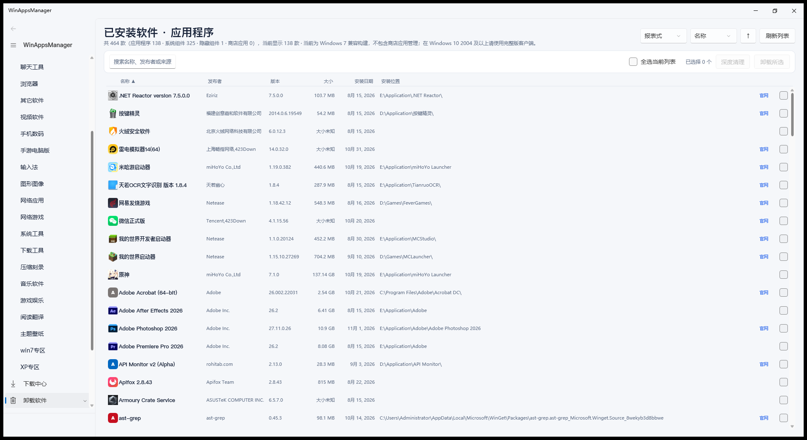

# WinAppsManager

Windows 软件管理器：像应用商店一样查找、下载和卸载 Windows 软件。软件源由服务端统一下发，默认包含联想应用商店、360 软件管家与内置精选，新增来源只需在服务端添加。

[](https://github.com/daijunhaoMinecraft/WinAppsManager/actions/workflows/build.yml) [](https://github.com/daijunhaoMinecraft/WinAppsManager/releases/latest)


## 功能

- **软件商店**：软件源由服务端统一下发（默认联想应用商店、360 软件管家、内置精选），随时切换；新增来源无需升级客户端。分类导航、排序、搜索、分页。
- **软件详情**：安装包大小、评分、开发者、版本、应用截图；下载链接可复制或打开。
- **下载中心**：分段并发下载、实时进度和速度、取消/重试/打开安装包；**支持断点续传**——取消或失败后会保留未完成的分片，按钮变成“继续下载”，从断点接着下（服务器不支持 Range 或文件已变化时自动从头重下）。每一行都能勾选，选中后可一次性删除安装包文件、移除记录，或停掉仍在下载的任务。支持 `.exe` / `.msi` / `.msix` / `.appx` / `.msu`（Windows 补丁包）。下载完成后显示安装包数字签名的签发公司、证书有效期和有效性（仅提示，不阻止打开）；服务端上报的 Size 不再参与下载校验，可选 SHA256 仍会校验。已结束的下载会持久化到 `%LOCALAPPDATA%\WinAppsManager\download-history.json`，重启后仍可查看并继续未完成的下载。
- **卸载与强制卸载**：桌面软件列表按本机 Windows 卸载登记动态生成，不维护预置的隐藏软件名称清单。分类规则：`SystemComponent=1` 归为系统组件，`DisplayName` 缺失或为空归为隐藏组件（显示名回退到注册表键名，故意不写 `DisplayName` 的安装器也能在这里被看到），其余为应用程序；隐藏组件不提供常规卸载，只能用“强制卸载”清理它的卸载键标识（如 `{GUID}.KB…`）及相关残留。另读取 Microsoft Store/MSIX 应用；卸载结束后刷新已安装列表判断软件是否还存在，确认移除后自动打开“强制卸载”窗口，由用户逐项选择残留（安全项默认勾选，安装目录/AppData/快捷方式/MSI 等危险项默认不勾选）。批量卸载多个软件时只打开一次强制卸载，逐个扫描并在窗口中显示当前软件，最后把多组残留合并去重成一个列表。删除文件前会检查文件句柄，并尝试结束占用该文件的普通用户进程后重试；仍无法删除的文件/文件夹登记为下次 Windows 重启删除。残留扫描由静态扫描实现：递归匹配 `Software` 下的同名键（跳过 SideBySide、Fusion、Installer、App Paths、.NETFramework、Component Based Servicing、Wow6432Node、Classes 等系统分支），并覆盖开始菜单/桌面/Quick Launch 快捷方式与 Windows Installer 产品、组件和源目录记录。停止卸载或关闭卸载进度窗口前会弹出二次确认（默认“否”），确认后才终止厂商卸载程序及其子进程。
- **自启动项管理**：与任务管理器“启动”页同源的清单——HKLM/HKCU 的 `Run` 与 `RunOnce`（HKLM 含 32 位 `WOW6432Node` 视图）、“所有用户”和“当前用户”的启动文件夹快捷方式、任务计划程序中“登录时触发且有可执行动作”的顶层任务，以及 Microsoft Store／UWP 应用声明的启动任务；`\Microsoft\` 下 Windows 自己的维护任务与任务管理器一样不列出。启用/禁用改写 Windows 自己的 `Explorer\StartupApproved` 审批表（与 msconfig、任务管理器同一机制）、任务自身的 Enabled 标志或 UWP 启动任务的 `State`，不删除条目，随时可以还原；删除才会真正移除登记并先二次确认（应用启动任务由应用声明，只能禁用不能删除）。支持按来源筛选、搜索、排序、拖动表头调整列宽（报表式的卸载页同样支持），以及按 8 种落点新增自启动项（所有用户／当前用户的 `Run` 与 `RunOnce`、两个开始菜单启动文件夹、登录时执行的计划任务）。列表的“名称”取主程序 exe 的“文件说明”（取不到才回退注册表值名／快捷方式名／任务名），并单列显示“公司”；鼠标悬停在计划任务上会显示任务自身的描述。商店应用的启动任务会显示应用自己的名称、发布公司与图标（如 `终端预览`、`ChatGPT`、`XBOX`），右键可直接跳到 Microsoft Store 的产品页。
- **重启删除提示**：清理结束后，若存在“重启后删除”或仍无法删除的项目，会列出具体路径并提供“立即重启”（5 秒后重启）或“完成”两个选项。
- **管理员权限**：客户端清单声明 `requireAdministrator`，启动即请求 UAC；强制卸载需要访问 HKLM/Program Files 并结束占用进程。
- **主题与设置**：浅色/深色/跟随系统；**主题色**可用预设色块一键切换，也可以打开调色盘（色相/饱和度/亮度 + 十六进制）自选任意颜色，按钮、勾选框、链接和进度环都会跟随；**背景图**可选一张本地图片铺满窗口，并能调不透明度，卡片与文字仍保持不透明。**窗口背景**可在“无（默认，不透明）/ 亚克力 / 云母 / 自动”之间切换，设置页会按当前系统禁用不可用的选项（云母需要 Windows 11 22H2 及以上，亚克力需要 Windows 10 1803 及以上，Windows 7/8 或高对比度下自动回退为纯色）；设置背景图后标题栏与导航栏改为对背景图做实时高斯模糊。另有自定义下载目录、线程数、代理和软件源。
- **界面动效**：页面切换统一交叉淡化（导航栏切换、进出软件详情），列表行依次淡入，弹窗弹出淡入。动画只做透明度合成，不做位移，页面内容再复杂也不掉帧；动效始终开启，不受 Windows 动画设置影响。
- **系统兼容**：单一 .NET 6 构建支持 Windows 7 SP1 / 8 / 8.1 / 10 / 11，按系统版本自动启用商店应用；内置 Fluent System Icons 图标字体，Win7 未安装 Segoe Fluent Icons 也不会出现方框图标。

## 截图

| 软件列表 | 软件详情 |
| --- | --- |
|  |  |

| 下载中心 | 设置与软件源 |
| --- | --- |
|  |  |

| 已安装软件 | 商店应用 |
| --- | --- |
|  |  |

| 强制卸载（清理残留） | 360 软件源 |
| --- | --- |
|  |  |

## 下载与运行

### 1. 下载自包含版本

从 [GitHub Releases](https://github.com/daijunhaoMinecraft/WinAppsManager/releases/latest) 下载自包含版本：

- `WinAppsManager-*-win-x64-selfcontained.zip`：64 位，适用于 Windows 7 SP1–11
- `WinAppsManager-*-win-x86-selfcontained.zip`：32 位，适用于 Windows 7 SP1–11

压缩包已内置 .NET 6 Desktop Runtime，**目标机器无需安装 .NET Runtime**；解压后运行 `WinAppsManager.exe` 即可。GitHub Actions 每次推送都会构建客户端并测试后端；发布版本由推送 `v<Version>` 标签（或手动触发 `Release` workflow）构建并上传，版本号与发布说明分别维护在仓库根目录的 `release.props` 和 `Release.md`。

### 2. 可选：本地启动后端

要求 Python 3.11+（推荐 3.12；`httpx2 2.16` 要求 Python 3.11+）。

```powershell
python -m venv Backend\.venv
Backend\.venv\Scripts\python.exe -m pip install -r Backend\requirements.txt
Backend\.venv\Scripts\python.exe Backend\main.py
```

后端默认监听 `http://127.0.0.1:8080`，接口文档 <http://127.0.0.1:8080/docs>。客户端默认连接在线服务端 `https://winapps.theconsole.top/`，本地运行时无需额外启动后端；需要本地开发或自建服务时可在设置中切换服务端地址。

### 3. 启动客户端

要求 .NET SDK 8+；运行客户端需要 .NET 6 Desktop Runtime。

```powershell
dotnet build WinAppsManager\WinAppsManager.sln -c Release
dotnet run --project WinAppsManager\WinAppsManager\WinAppsManager.csproj
```

只有一套 `net6.0-windows7.0` 构建：Windows 7 SP1–11 使用同一个客户端，启动时检查系统版本；Windows 10 / 11 自动启用 Microsoft Store / MSIX 应用管理，Windows 7 / 8 只显示桌面软件。需要独立安装包时使用 `Properties/PublishProfiles` 中的 x64/x86 配置发布。

## 使用方法

1. 启动客户端，默认连接在线服务端 `https://winapps.theconsole.top/`；本地开发可启动 `Backend` 后在设置中切换为 `http://127.0.0.1:8080/`。
2. 在**设置 → 软件源**选择需要的软件源；列表和服务端地址均可修改，来源能力（分类、搜索方式、截图/视频等）由服务端下发。
3. 在**软件列表**搜索或按分类浏览，打开详情查看截图并点击“开始下载”。
4. 下载任务进入**下载中心**，完成后可查看安装包数字签名（签发公司、证书有效期、是否有效），再打开安装包或下载文件夹。取消或失败的下载会保留分片，按钮变成“继续下载”后可以从断点接着下；每行左侧的复选框支持多选，选中后可一次删除安装包、移除记录，正在下载的会先被停掉。
5. 在**卸载软件**勾选要卸载的程序，点击“卸载所选”；卸载结束后会刷新安装列表核对结果，确认软件已不存在后自动打开“强制卸载”窗口，由你手动选择要清理的残留项。
6. 也可选中任意软件点“强制卸载”手动扫描残留；安装目录、AppData、快捷方式等危险项默认不勾选，确认后再点“删除选中”。
7. 在**自启动项**查看、搜索和按来源筛选开机自启项；名称显示主程序 exe 的“文件说明”（取不到时回退登记名，悬停可看到原始登记名，计划任务还会显示任务描述），“公司”列显示发布公司；行尾复选框勾选即启用、取消即禁用（不删除条目，随时可还原）。右键提供“启动时禁止/允许运行”“从列表中删除”“浏览程序位置…”“浏览来源…”。拖动表头分隔条可调整列宽以看清长名称，报表式的**卸载软件**页也支持同样操作。顶部“添加自启动项”可按启动类型把任意程序写入所有用户／当前用户的 `Run`、`RunOnce`、开始菜单启动文件夹，或创建登录时执行的计划任务。
8. 在**设置 → 外观**切换浅色/深色/跟随系统，点色块或“自定义颜色…”挑主题色，还可以选一张背景图并调整不透明度；所有外观改动立即生效并自动保存。

搜索方式由服务端 `search_mode` 决定：目录完整时客户端本地搜索，否则自动调用服务端搜索 API；切换源后目录和左侧分类会自动更新。卸载结果以刷新后的已安装列表为准，不再以卸载程序退出码为准；确认已卸载后会自动打开“强制卸载”窗口，由你手动选择残留项。

## 常见问题

**Win7 能运行吗？** 可以，同一套客户端支持 Win7 SP1–11；Windows 7/8 没有商店应用，Windows 10/11 会自动显示商店应用。

**需要单独安装数据库或服务吗？** 不需要。后端是单进程 FastAPI 服务，默认只监听本机，数据和缓存保存在 `Backend\.cache`。

**卸载不掉的软件怎么办？** 先尝试正常卸载；如果卸载程序失败或留下残留，可用“强制卸载”扫描并清理残留文件和注册表项。它不会强制结束正在运行的程序。

**软件图标/截图不显示？** 图片优先从软件源 CDN 加载，失败会自动回退到后端代理；请检查网络，或在设置中切换服务端。

## License

WinAppsManager is licensed under the **PolyForm Noncommercial License 1.0.0** with additional source-sharing and non-resale terms. Commercial use, resale, paid distribution, and closed-source distribution are not permitted. See [LICENSE](LICENSE).

Copyright (c) 2026 daijunhaoMinecraft

Lenovo, 360, and their respective product names, data, icons, and trademarks belong to their owners; this project is not affiliated with or endorsed by them.
The bundled Fluent System Icons font comes from Microsoft `fluentui-system-icons` and is used under the MIT License (see `WinAppsManager/Assets/Fonts/LICENSE.txt`).

## 开发文档

- 后端接口与配置：[Backend/README.md](Backend/README.md)
- 软件源统一接口契约：[docs/source-api.md](docs/source-api.md)
- 软件源与设计说明：[docs/store-source-design.md](docs/store-source-design.md)
- 联想接口调研：[docs/lenovo-store-api.md](docs/lenovo-store-api.md)
- 360 接口调研：[docs/soft360-store-api.md](docs/soft360-store-api.md)、[docs/soft360-search-api.md](docs/soft360-search-api.md)
- 部署与安全：[docs/deploy.md](docs/deploy.md)
