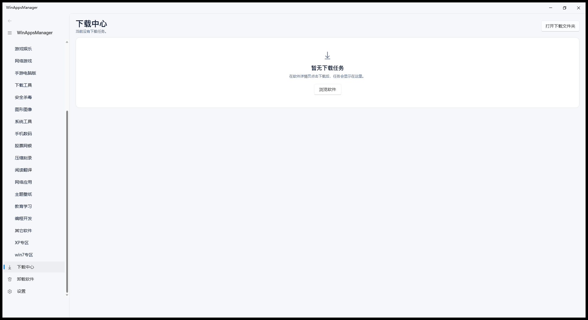
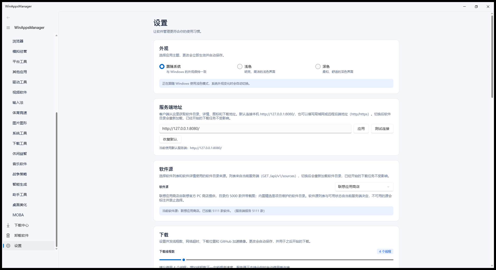
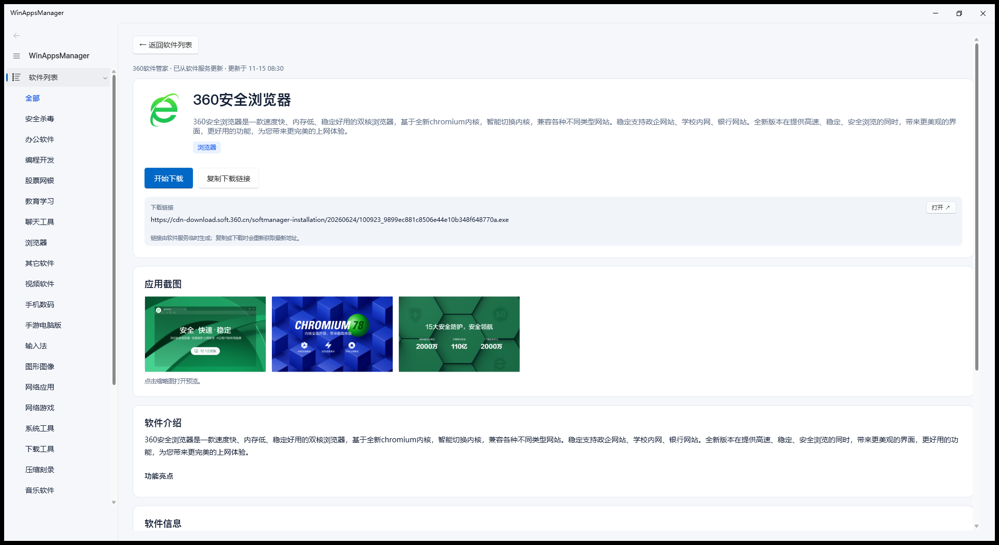

# WinAppsManager

Windows 软件管理器：WPF 桌面前端 + FastAPI 后端，支持联想应用商店、360 软件管家与内置精选三个软件源，提供软件目录、详情、截图、下载、卸载与残留清理。

> 非商业源码许可（不是 OSI 开源许可）：允许个人学习、研究与非商业使用，**禁止商业使用、倒卖、销售或付费分发**。详见 [LICENSE](LICENSE)。


## 功能

- **软件目录**：三个可切换的软件源（联想应用商店 / 360 软件管家 / 内置精选），分类导航、排序、分页、搜索；目录由后端缓存并定时更新。
- **软件详情**：安装包大小、评分、开发者、分类、版本、多张应用截图，下载链接可复制/打开。
- **下载中心**：并发分段下载、实时进度与速度、取消/重试/移除、打开安装包或下载目录；不自动运行安装包。
- **卸载与残留清理**：读取 Windows 卸载注册表与当前用户 MSIX/商店应用，支持分类、搜索、批量卸载；卸载后可深度清理注册表项、安装目录、AppData、开始菜单/桌面快捷方式与 MSI 安装数据库，危险项默认不勾选，逐条校验后再删除。
- **软件源与后端解耦**：软件源列表由服务端 `GET /api/v1/sources` 动态提供（含 `search_mode`：`catalog` 本地全量搜索 / `api` 服务端 API 搜索）；切换源后立即重新加载目录，左侧分类导航自动更新。后端地址可在设置中修改。
- **体验与兼容**：浅色/深色/跟随系统主题、按系统架构过滤目录、Win7 SP1 兼容构建（net6）与 Win10 2004+ 完整构建（net8）、客户端/后端文件日志。

### 深度清理残留

卸载软件常留下注册表项、安装目录、AppData、开始菜单/桌面快捷方式和 MSI 安装数据库条目。WinAppsManager 在卸载后提供“深度清理残留…”：

- 扫描九组位置：卸载登记项、`HKCU/HKLM\Software` 同名键、Run/RunOnce、启动项、Services、App Paths、安装目录、AppData/ProgramData、开始菜单/桌面快捷方式、MSI 产品/文件夹记录；
- 结果按“文件夹 → 文件”展示，带大小与完整路径；**危险分组默认不勾选**，勾选后才删除；
- 删除前逐条重新校验路径/注册表分支，只删勾选项，先删文件后清空目录，盘根、Windows、Program Files 等受保护位置一律拒绝；
- 卸载过程支持停止，并按注册表/包是否存在核对卸载是否真正完成。


## 截图

| 软件列表 | 软件详情 |
| --- | --- |
|  |  |

| 下载中心 | 设置与软件源 |
| --- | --- |
|  |  |

| 联想商店视频预览 | 360 软件源 |
| --- | --- |
|  |  |

| 360 应用详情 | API 文档 |
| --- | --- |
|  |  |

## 快速开始

要求：Windows 10/11 开发机，Python 3.10+，.NET SDK 8+；运行客户端需 .NET 6/8 Desktop Runtime（Win7 只能使用 net6 目标，且不含商店应用）。

### 后端

```powershell
python -m venv Backend\.venv
Backend\.venv\Scripts\python.exe -m pip install -r Backend\requirements.txt
Backend\.venv\Scripts\python.exe Backend\main.py
```

默认监听 `http://127.0.0.1:8080`，接口文档 <http://127.0.0.1:8080/docs>（Swagger 资源随后端提供，不依赖外网 CDN）。首次启动会加载软件目录、启动定时刷新线程；联想/360 目录来自 `Backend\.cache` 缓存，GET 请求只读缓存，不提供强制刷新参数。

### 客户端

```powershell
dotnet build WinAppsManager\WinAppsManager.sln -c Release
dotnet run --project WinAppsManager\WinAppsManager\WinAppsManager.csproj -f net6.0-windows7.0
```

默认连接本机后端，可在**设置 → 服务端地址**修改；下载目录、线程数、超时、代理、GitHub 镜像、主题等也在设置页配置。

## 软件源

| 软件源 | 内容 | 说明 |
| --- | --- | --- |
| 联想应用商店（默认） | 约 5111 款软件与游戏，含截图、版本、评分、下载量、更新说明 | 后端代理联想 PC 商店接口并缓存；图标/截图/封面客户端直连 CDN，失败回退后端代理；`search_mode=catalog`（本地全量搜索） |
| 360 软件管家 | 目录为 24 个分类各前 3 页（约 5940 款热门子集）；**在线搜索覆盖 360 全量目录**（逆向了 `enc_client` 搜索接口，见 [docs/soft360-search-api.md](docs/soft360-search-api.md)） | 后端代理 360 目录与搜索接口；图标/截图客户端直连 CDN，失败回退后端代理；`search_mode=api`（服务端 API 全量搜索）；目录可扩大 `soft360.catalog_pages_per_category` |
| 内置精选 | 项目维护的 45 款软件资料，默认只启用 Clash Verge Rev 与 Telegram（`builtin.app_ids`） | 后端解析官网/GitHub 版本与下载地址；其余条目保留但不预热 |

软件源列表由当前服务端决定：服务端不可用的源会在设置页标灰且不能选择；已保存的源不可用时自动回退到服务端默认源。切换源会清空按源隔离的目录缓存并立即在后台重新加载（停留在设置页时左侧分类导航也会自动更新），已经开始的下载任务不受影响。搜索方式读取 `/sources` 的 `search_mode`：`catalog` 模式在客户端完整目录内本地搜索（联想、内置精选），`api` 模式在输入时自动调用服务端搜索 API（360，覆盖全量目录）；旧服务端缺少该字段时按源回退。图片不维护固定域名白名单：详情截图与封面返回任意安全公网 CDN 地址，客户端直连失败才回退后端 `proxy_url`/`cover_proxy_url`，从而减少后端图片带宽。

接口与配置细节见 [Backend/README.md](Backend/README.md)，联想/360 接口调研见 [docs/lenovo-store-api.md](docs/lenovo-store-api.md)、[docs/soft360-store-api.md](docs/soft360-store-api.md)，整体设计见 [docs/store-source-design.md](docs/store-source-design.md)。

## 项目结构

```text
WinAppsManager/
  WinAppsManager/        WPF 客户端（net6 / net8 双目标）
    Models/              数据模型、设置、软件源 DTO
    Pages/               软件列表、详情、下载中心、卸载、设置
    Dialogs/             截图预览、卸载确认/进度、深度清理
    Services/            目录/下载/设置/日志/卸载与残留扫描
  Backend/               FastAPI 后端
    main.py              应用入口、路由、缓存与定时刷新接线
    data/                内置精选 45 款软件资料与图标
    lenovo/              联想应用商店源
    soft360/             360 软件管家源（目录/详情/加密搜索/图片）
    tests/               unittest 测试
  docs/                  接口调研、设计、部署与截图
```

## 配置与部署

- 后端配置：`Backend/config.json`，可被 `Backend/config.local.json`（gitignore）和 `WINAPPSMANAGER_*` 环境变量覆盖；完整字段见 [Backend/README.md](Backend/README.md)。
- 常用：`lenovo.catalog_refresh_interval_seconds`（默认 300）、`soft360.catalog_pages_per_category`（默认 3，1–20）、`soft360.catalog_refresh_interval_seconds`（默认 1800）、`logging.*`。
- 公网部署：`Dockerfile` / `docker-compose.yml` / `deploy/` 下 systemd 与 Caddy 示例，步骤与安全清单见 [docs/deploy.md](docs/deploy.md)。

## 验证

```powershell
# 后端全量测试（离线，不访问真实网络）
Backend\.venv\Scripts\python.exe -m unittest discover -s Backend\tests

# 客户端双目标构建（0 警告、0 错误）
dotnet build WinAppsManager\WinAppsManager.sln -c Release
```

## 许可证与仓库计划

本项目采用自定义《WinAppsManager 非商业源代码许可协议 1.0》：

- 允许个人学习、研究、非商业使用、修改与分发（保留版权与许可声明）；
- **禁止商业使用、倒卖、销售、付费分发、商业托管/SaaS、广告变现**；商业使用需作者书面授权；
- 这是 **source-available** 许可，不是 OSI 认可的开源许可；联想/360 的名称、数据、图标与商标归各自权利人，本项目与它们无隶属或背书关系。

仓库当前为私有；API 服务部署与安全审查完成后再转为公开，检查项见 [docs/deploy.md](docs/deploy.md#5-转为公开仓库部署完成后)。
