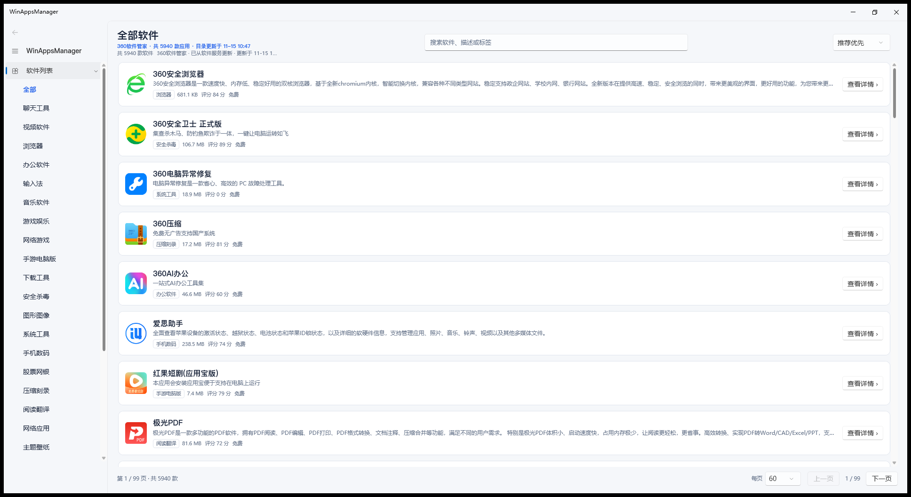
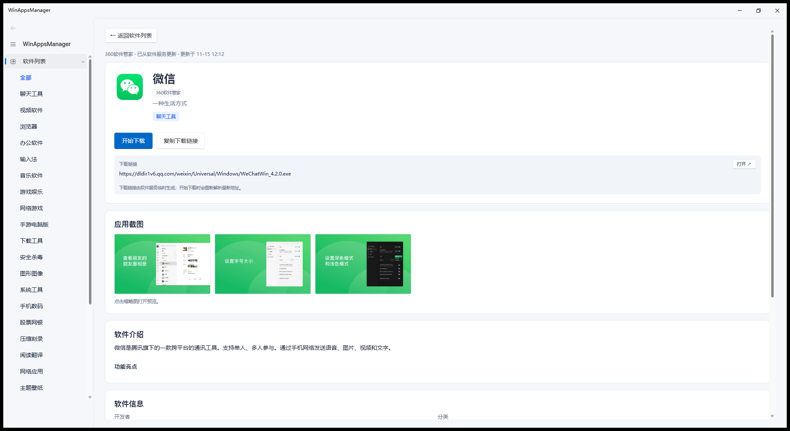
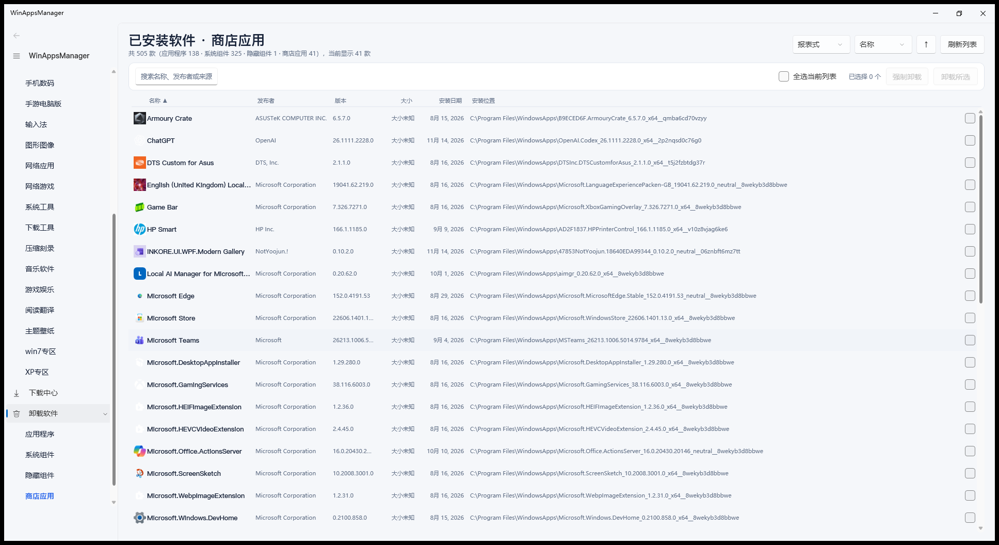
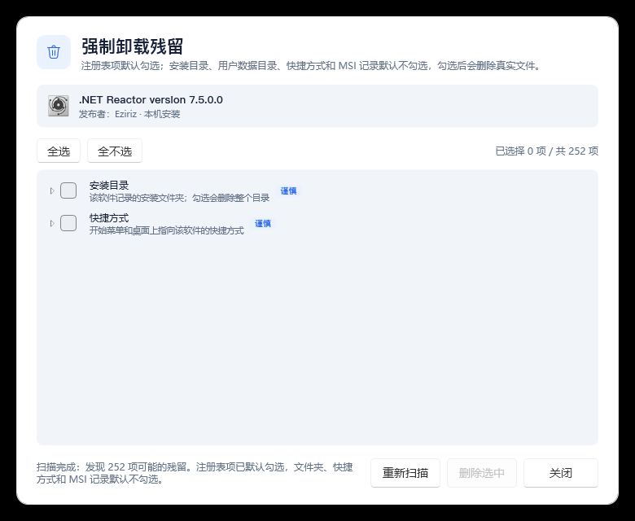

# WinAppsManager

Windows 软件管理器：像应用商店一样查找、下载和卸载 Windows 软件。软件源由服务端统一下发，默认包含联想应用商店、360 软件管家与内置精选，新增来源只需在服务端添加。



## 功能

- **软件商店**：软件源由服务端统一下发（默认联想应用商店、360 软件管家、内置精选），随时切换；新增来源无需升级客户端。分类导航、排序、搜索、分页。
- **软件详情**：安装包大小、评分、开发者、版本、应用截图；下载链接可复制或打开。
- **下载中心**：分段并发下载、实时进度和速度、取消/重试/打开安装包。
- **卸载与强制卸载**：读取 Windows 卸载注册表和 Microsoft Store/MSIX 应用，分类、搜索、批量卸载；卸载结束后刷新已安装列表判断软件是否还存在，确认不存在后自动清理默认安全残留（如卸载登记项、启动项）。也可点击“强制卸载”手动扫描注册表、安装目录、AppData、快捷方式和 MSI 记录，危险项默认不勾选，逐条校验后删除。
- **主题与设置**：浅色/深色/跟随系统，自定义下载目录、线程数、代理和软件源。
- **系统兼容**：单一 .NET 6 构建支持 Windows 7 SP1 / 8 / 8.1 / 10 / 11，按系统版本自动启用商店应用；内置 Fluent System Icons 图标字体，Win7 未安装 Segoe Fluent Icons 也不会出现方框图标。

## 截图

| 软件列表 | 软件详情 |
| --- | --- |
|  |  |

| 下载中心 | 设置与软件源 |
| --- | --- |
|  |  |

| 已安装软件 | 商店应用 |
| --- | --- |
|  |  |

| 强制卸载（清理残留） | 360 软件源 |
| --- | --- |
|  |  |

## 下载与运行

仓库当前为私有，暂未提供预编译安装包；可以从源码构建运行。

### 1. 启动后端

要求 Python 3.10+。

```powershell
python -m venv Backend\.venv
Backend\.venv\Scripts\python.exe -m pip install -r Backend\requirements.txt
Backend\.venv\Scripts\python.exe Backend\main.py
```

后端默认监听 `http://127.0.0.1:8080`，接口文档 <http://127.0.0.1:8080/docs>。

### 2. 启动客户端

要求 .NET SDK 8+；运行客户端需要 .NET 6 Desktop Runtime。

```powershell
dotnet build WinAppsManager\WinAppsManager.sln -c Release
dotnet run --project WinAppsManager\WinAppsManager\WinAppsManager.csproj
```

只有一套 `net6.0-windows7.0` 构建：Windows 7 SP1–11 使用同一个客户端，启动时检查系统版本；Windows 10 / 11 自动启用 Microsoft Store / MSIX 应用管理，Windows 7 / 8 只显示桌面软件。需要独立安装包时使用 `Properties/PublishProfiles` 中的 x64/x86 配置发布。

## 使用方法

1. 启动后端和客户端，客户端默认连接本机后端。
2. 在**设置 → 软件源**选择需要的软件源；列表和服务端地址均可修改，来源能力（分类、搜索方式、截图/视频等）由服务端下发。
3. 在**软件列表**搜索或按分类浏览，打开详情查看截图并点击“开始下载”。
4. 下载任务进入**下载中心**，完成后可打开安装包或下载文件夹。
5. 在**卸载软件**勾选要卸载的程序，点击“卸载所选”；卸载结束后会刷新安装列表核对结果，确认软件已不存在后自动清理默认安全残留。
6. 也可选中任意软件点“强制卸载”手动扫描残留；安装目录、AppData、快捷方式等危险项默认不勾选，确认后再点“删除选中”。

搜索方式由服务端 `search_mode` 决定：目录完整时客户端本地搜索，否则自动调用服务端搜索 API；切换源后目录和左侧分类会自动更新。卸载结果以刷新后的已安装列表为准，不再以卸载程序退出码为准；确认已卸载后会自动清理默认安全残留。

## 常见问题

**Win7 能运行吗？** 可以，同一套客户端支持 Win7 SP1–11；Windows 7/8 没有商店应用，Windows 10/11 会自动显示商店应用。

**需要单独安装数据库或服务吗？** 不需要。后端是单进程 FastAPI 服务，默认只监听本机，数据和缓存保存在 `Backend\.cache`。

**卸载不掉的软件怎么办？** 先尝试正常卸载；如果卸载程序失败或留下残留，可用“强制卸载”扫描并清理残留文件和注册表项。它不会强制结束正在运行的程序。

**软件图标/截图不显示？** 图片优先从软件源 CDN 加载，失败会自动回退到后端代理；请检查网络，或在设置中切换服务端。

## 许可证

本项目采用自定义《WinAppsManager 非商业源代码许可协议 1.0》：允许个人学习、研究、非商业使用与修改；**禁止商业使用、倒卖、销售、付费分发**。这是 source-available 许可，不是 OSI 认可的开源许可。详见 [LICENSE](LICENSE)。

联想应用商店、360 软件管家的名称、数据、图标与商标归各自权利人，本项目与它们无隶属或背书关系。
客户端内置的 Fluent System Icons 字体来自 Microsoft `fluentui-system-icons`，使用 MIT 许可证（见 `WinAppsManager/Assets/Fonts/LICENSE.txt`）。

## 开发文档

- 后端接口与配置：[Backend/README.md](Backend/README.md)\n- 软件源统一接口契约：[docs/source-api.md](docs/source-api.md)
- 软件源与设计说明：[docs/store-source-design.md](docs/store-source-design.md)
- 联想接口调研：[docs/lenovo-store-api.md](docs/lenovo-store-api.md)
- 360 接口调研：[docs/soft360-store-api.md](docs/soft360-store-api.md)、[docs/soft360-search-api.md](docs/soft360-search-api.md)
- 部署与安全：[docs/deploy.md](docs/deploy.md)
